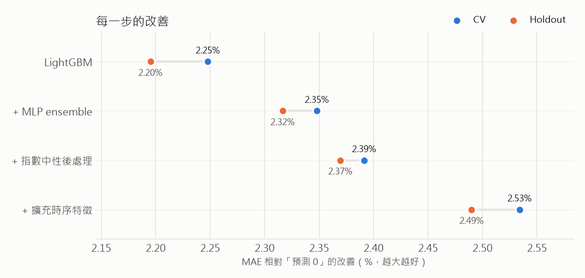
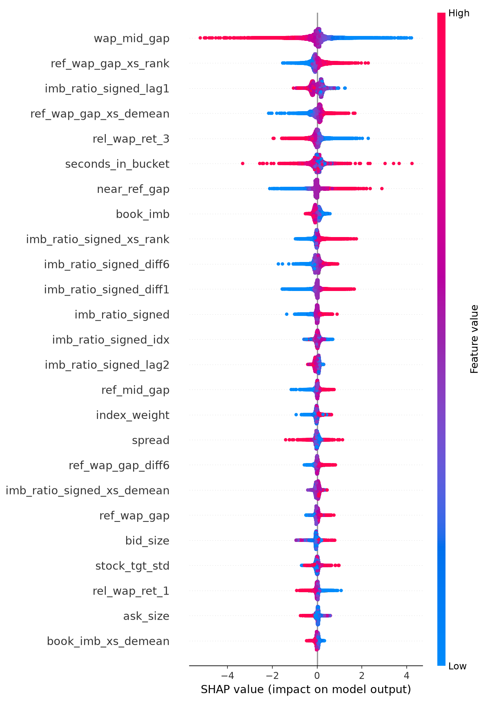

# Optiver Trading at the Close — Nasdaq 收盤競價價格預測

> **一句話摘要**：以 purged walk-forward CV 訓練 LightGBM + MLP ensemble，預測個股 WAP 未來 60 秒相對合成指數的變動（bps）。
> CV MAE **6.1404** · Holdout MAE **5.8138**（各比預測 0 低 2.53% / 2.49%，擴充時序特徵 + 指數中性後處理）。



每一步都疊在前一步之上，數字是 MAE 相對「預測 0」的改善；CV 與 holdout 的改善幅度一致（`python scripts/plot_results.py`）。

## 1. 問題背景

Nasdaq 每天 15:50–16:00 進行 Closing Cross：交易所每 10 秒公布一次競價資訊（已配對量、未配對量 imbalance、參考價、far / near price），最後以單一價格撮合收盤單。收盤價是指數基金與衍生品結算的基準，收盤前 10 分鐘的價格發現對做市商很重要。本題要預測每支股票 WAP 未來 60 秒相對加權指數的超額報酬，以 MAE 評分。

## 2. 驗證設計

```
dates:  |=============== CV 可用日期 (90%) ===============|== holdout (10%) ==|
fold 0: [train ............]  gap  [val]
fold 1: [train ..................]  gap  [val]
fold 2: [train ........................]  gap  [val]
...                              (gap = embargo_days)
```

- **以 `date_id` 切分**，不隨機切：同一天不同股票的資料共享同一個市場狀態。
- **Walk-forward expanding window**：每折用之前所有日期訓練，驗證接下來的一段。
- **Embargo**：訓練集最後一天與驗證集之間空 `embargo_days` 天。target 只看 60 秒、不跨日，理論上不需要太長，但這是好習慣。
- **Holdout**：最後 10% 日期完全不碰，`--holdout` 只跑一次，紀錄在 `<output_dir>/holdout_log.csv`（同一資料夾重複使用會跳警告）。目前共用過兩次：原本特徵一次、擴充時序特徵一次（見第 3 節）。
- **指數權重**只用第一折的訓練日期估計（它是所有折訓練集的子集）。
- **洩漏測試**（`tests/test_leakage.py`，CI 自動跑）：竄改未來秒數或其他天的原始資料，檢查過去的特徵完全不變。

## 3. 結果

| 模型 | CV MAE | Holdout MAE | CV 訓練時間（5 折） |
| --- | --- | --- | --- |
| 預測 0 | 6.3001 | 5.9623 | — |
| *原本特徵（`configs/base.yaml`，119 個）* | | | |
| LightGBM | 6.1585（−2.25%） | 5.8314（−2.20%） | 28 分鐘（6 執行緒） |
| MLP | 6.1656（−2.13%） | 5.8361（−2.12%） | 65 分鐘（4 執行緒） |
| Ensemble（nested 權重） | 6.1522（−2.35%） | 5.8242（−2.32%） | — |
| Ensemble + 指數中性後處理 | 6.1494（−2.39%） | 5.8210（−2.37%） | — |
| *擴充時序特徵（`configs/temporal_wide.yaml`，239 個）* | | | |
| LightGBM | 6.1525（−2.34%） | 5.8228（−2.34%） | 37 分鐘（6 執行緒） |
| MLP | 6.1578（−2.26%） | 5.8317（−2.19%） | 68 分鐘（6 執行緒） |
| Ensemble（nested 權重） | 6.1438（−2.48%） | 5.8164（−2.45%） | — |
| Ensemble + 指數中性後處理 | **6.1404（−2.53%）** | **5.8138（−2.49%）** | — |
| *擴充時序特徵 + LightGBM 學習率 0.02（`configs/lgb_lr002.yaml`，只跑 CV）* | | | |
| LightGBM | 6.1493（−2.39%） | 未跑 | 111 分鐘（6 執行緒） |
| Ensemble（nested 權重，搭配上面的 MLP） | 6.1428（−2.50%） | 未跑 | — |
| Ensemble + 指數中性後處理 | 6.1392（−2.55%） | 未跑 | — |
| *再加 MLP 多種子平均（`configs/mlp_seeds.yaml`，只跑 CV）* | | | |
| MLP（種子 42 / 43 / 44 平均） | 6.1501（−2.38%） | 未跑 | 137 分鐘（6 執行緒） |
| Ensemble（LightGBM lr 0.02 + 3 種子 MLP） | 6.1414（−2.52%） | 未跑 | — |
| Ensemble + 指數中性後處理 | 6.1380（−2.57%） | 未跑 | — |
| *再加 GRU 序列模型（`configs/gru.yaml`，只跑 CV）* | | | |
| GRU | 6.1713（−2.04%） | 未跑 | 79 分鐘（6 執行緒） |
| Ensemble（LightGBM + MLP + GRU） | 6.1402（−2.54%） | 未跑 | — |
| Ensemble + 指數中性後處理 | 6.1371（−2.59%） | 未跑 | — |
| *LightGBM 改為每 15 天定期重訓（`configs/lgb_refit.yaml`，學習率 0.05，只跑 CV）* | | | |
| LightGBM（每 15 天重訓） | 6.1476（−2.42%） | 未跑 | 138 分鐘（6 執行緒） |
| Ensemble（重訓 LightGBM + 3 種子 MLP + GRU） | 6.1387（−2.56%） | 未跑 | — |
| Ensemble + 指數中性後處理 | 6.1358（−2.61%） | 未跑 | — |
| *再加跨股票 Transformer（`configs/xformer.yaml`，只跑 CV）* | | | |
| Transformer | 6.1584（−2.25%） | 未跑 | 107 分鐘（6 執行緒） |
| Ensemble（重訓 LightGBM + MLP + GRU + Transformer） | 6.1369（−2.59%） | 未跑 | — |
| Ensemble + 指數中性後處理 | **6.1348（−2.62%）** | 未跑 | — |

括號內為相對預測 0 的改善。Holdout 為最後 48 天，模型以全部 CV 日期（扣掉 embargo）重新訓練，輪數與 epoch 數取 CV 的平均最佳值（原本特徵：LightGBM 557 輪、MLP 10 epoch；擴充後：566 輪、9 epoch）；ensemble 權重只在 OOF 上決定（原本 0.59 / 0.41，擴充後 0.56 / 0.44），未在 holdout 上調整。兩個資料期間的波動不同，絕對值不能直接比，看相對改善：CV 與 holdout 幾乎一致，代表沒有對驗證期過擬合。

兩模型相關係數：原本特徵 OOF 0.893、holdout 0.879；擴充後 OOF 0.879、holdout 0.873（`reports/ensemble_report.json`、`reports/temporal_wide/ensemble_report.json`）。ensemble 在 5 折都優於兩個單一模型；簡單平均（各 0.5）的 CV MAE 與最佳權重幾乎相同（原本 6.1525、擴充後 6.1440）。

**擴充時序特徵**：ablation 顯示 temporal 是最重要的特徵組，因此把做 lag / diff 的欄位從 6 個加到 13 個（spread、wap_mid_gap、imb_vs_book、liquidity 與各種價差）、lag 與移動平均延長到 12 格（2 分鐘）、報酬區間加入 12 與 24 格，並加上「相對當天第一格的變化」。LightGBM 與 MLP 的 CV 在 5 折都變好，ensemble + 後處理在 CV 改善 0.0090、holdout 改善 0.0072。新特徵中 `imb_ratio_signed_since_open`、`idx_wap_ret_24`、`idx_wap_ret_12` 都進入 LightGBM 重要度前 15 名。

**LightGBM 學習率 0.02**：特徵與 MLP 都和擴充時序特徵相同，只把 LightGBM 學習率從 0.05 降到 0.02（輪數上限 5000、early stopping 200）。5 折 CV 全部變好（−0.0019 到 −0.0044），LightGBM 6.15251 → 6.14934；但 ensemble + 後處理只從 6.14043 改善到 6.13917（0.0013），訓練時間卻是 3 倍（平均最佳輪數 1840，原本約 566）。ensemble 權重 0.60 / 0.40，兩模型 OOF 相關係數 0.888。**只有 CV、沒有跑 holdout**：holdout 已用過兩次，這個改善幅度不足以值得第三次動用，因此頂端摘要與結果圖仍以學習率 0.05 的版本為準（`reports/lgb_lr002/`）。

**MLP 多種子平均**：同一折用種子 42、43、44 各訓練一個 MLP（前處理共用），預測取平均。單一種子的 CV 在 6.1573–6.1581 之間，平均後 6.1501，5 折都改善 0.0065–0.0099；種子 42 與原本的單一種子結果完全相同，可重現。但併進 ensemble 只從 6.1392 改善到 6.1380（0.0012）：單一 MLP 的隨機誤差本來就有一大部分在和 LightGBM 平均時抵銷，平均後的 MLP 與 LightGBM 相關係數從 0.888 升到 0.908，最佳權重變成各 0.5。**只有 CV、沒有跑 holdout**（`reports/mlp_seeds/`）。

**GRU 序列模型**：同一檔股票當天的 55 個時點當成一條序列，用單向 GRU（2 層、hidden 128）逐格預測；第 t 格的輸出只看得到第 0..t 格，`tests/test_gru.py` 竄改後面的時點、確認前面的預測不變。刻意拿掉 temporal 特徵組（只剩 59 個特徵），時間上的變化交給 GRU 自己學。單獨看最弱（CV 6.1713，每折都比 MLP 差 0.018–0.026，第 6–7 個 epoch 後開始過擬合），但與 LightGBM / MLP 的相關係數只有 0.859 / 0.869，是三者中差異最大的，ensemble 權重 0.16（LightGBM 0.44、MLP 0.39）。加入後 ensemble + 後處理從 6.1380 到 6.1371（0.0009），5 折都小幅改善。**只有 CV、沒有跑 holdout**（`reports/gru/`）；GRU 目前只有一個種子、沒調參，還有改善空間。

**LightGBM 定期重訓**：比賽測試期每天會揭露前一天的 target，所以驗證期每 15 天用「原本的訓練日期 + 這段開始前已揭露的日期」（包含 embargo 那幾天與之前的驗證日）重訓一次 LightGBM，第一段直接用原本的模型。每次重訓的輪數固定為該折 early stopping 的最佳輪數，stock 統計特徵也用重訓資料重算；`tests/test_refit.py` 檢查每段只用到它開始之前的日期。5 折都變好（−0.0027 到 −0.0085，越後面的折原本訓練資料越多、改善越小），LightGBM 6.15251 → 6.14762（0.0049），是目前單一改動中最大的；學習率維持 0.05，比降到 0.02（6.14934）更好、也較快。三模型 ensemble 只把 LightGBM 換成重訓版（MLP、GRU 沒重訓），ensemble + 後處理從 6.1371 到 6.1358。注意固定輪數取自同一折驗證期的 early stopping，與其他實驗相同，略為樂觀。**只有 CV、沒有跑 holdout**（`reports/lgb_refit/`，OOF 內也存了不重訓的 `pred_static` 供比較）。

**跨股票 Transformer**：target 是「個股 − 指數」，同一時刻其他股票在做什麼很重要，但前面的模型一次只看一檔股票。這裡把同一時點（同一天、同一秒）的約 200 檔股票當成一組，每檔是一個 token（特徵 + stock embedding，不加位置編碼），用 2 層 self-attention（寬度 64、4 個 head）讓每檔股票看到其他股票；同一時點的資料在比賽中是同時給出的，不會用到未來資訊。沒有時間維度，所以保留全部 temporal_wide 特徵。當時沒有資料的股票補位、不參與 attention 也不算進 loss；`tests/test_xformer.py` 檢查補位不影響真實股票、調換股票順序只會讓預測跟著調換，以及改一檔股票會影響其他股票的預測。單一種子 CV 6.1584：5 折都比 GRU 好（0.006–0.021），比 MLP 單一種子（6.1578）略差，最佳 epoch 只有 2–5。與重訓 LightGBM / 3 種子 MLP 的相關係數 0.861 / 0.892；四模型權重 LightGBM 0.41、MLP 0.26、Transformer 0.23、GRU 0.10，ensemble + 後處理從 6.1358 到 6.1348，5 折中 4 折改善（fold 3 差 0.0008）。不放 GRU 的三模型為 6.1352，GRU 的貢獻大多被 Transformer 取代。**只有 CV、沒有跑 holdout**（`reports/xformer/`）；目前只有一個種子、沒調參。

這五個只看 CV 的實驗（學習率 0.02、多種子、GRU、定期重訓、Transformer）各自只帶來約 0.001–0.005 的改善，加起來 ensemble + 後處理的 CV 從 6.1404 到 6.1348。頂端摘要與結果圖仍以有 holdout 驗證的版本為準。

**Holdout 使用了兩次**：第一次評估原本特徵，第二次評估擴充時序特徵。新特徵是依 CV 結果決定的，沒有看過 holdout，所以第二次的分數仍大致公正；但之後若再依 holdout 分數挑選做法，它就不再是乾淨的評估集。

**指數中性後處理**：target 是「個股 − 指數」，同一時點依指數權重加權後約為 0（實測平均 |·| 只有 0.04–0.05 bps），但模型預測的加權平均有 0.15–0.22 bps，混進了不該有的「整體漲跌」成分。每個時點把預測減掉它的指數加權平均（只對有資料的股票、權重重新正規化）後，兩個單一模型與 ensemble 在 CV 和 holdout 都改善約 0.003（LightGBM 6.1551 / 5.8281，MLP 6.1627 / 5.8323）。係數固定為 1，不調參：在 OOF 上掃 0–1.5，0.8–1.2 之間的差異小於 0.0005。

## 4. 哪些特徵有效、為什麼

| 特徵組 | 例子 | 市場理由 | 拿掉後 ΔMAE（CV） |
| --- | --- | --- | --- |
| basic | spread、book imbalance | 掛單量不對稱反映短期買賣壓力 | +0.0006 |
| auction | imbalance / matched、帶方向 imbalance | 未配對量會推動最終收盤價 | +0.0027 |
| time | time_to_close、300 秒旗標 | 300 秒後才有 far / near price | +0.0011 |
| temporal | lag、diff、rolling mean（只往前看） | 失衡在擴大還是收斂 | **+0.0164** |
| cross_sectional | 減去同時點平均、排名 | target 是相對指數 | +0.0002 |
| index | 個股報酬減加權指數報酬 | 直接對應 target 定義 | +0.0018 |
| stock | 個股 target 波動度（只從訓練折算） | 不同股票雜訊尺度不同 | +0.0020 |

ΔMAE 為拿掉該組後 LightGBM 5 折 CV MAE 的增加量（以原本 119 個特徵做，完整特徵 6.15846，數字越大代表越重要），來自 `python -m src.analyze ablation`（`reports/ablation.md`）。原始欄位（價格、量、`seconds_in_bucket`、`stock_id` 等）每次都保留，沒有做 ablation。

- **temporal 遠比其他組重要**：拿掉後變差 0.0164，是第二名的 6 倍。失衡在擴大還是收斂，比單一時點的數值更有資訊。
- **auction、stock、index、time 各貢獻 0.001–0.003**。
- **cross_sectional 與 basic 拿掉幾乎沒影響**，但這不代表它們沒有資訊：SHAP 顯示 cross_sectional 是模型第二常用的一組，SHAP 最重要的單一特徵 `wap_mid_gap` 也屬於 basic。兩者的差異來自特徵重疊，拿掉一組時，模型能從其他特徵補回大部分資訊，例如 basic 的價差類特徵可由原始的 bid / ask / wap 重建，cross_sectional 的相對資訊有一部分由 index 組提供。



SHAP（原本特徵、最後一折的模型、驗證集抽 2 萬筆）依組加總的平均 |SHAP|：temporal 1.48、cross_sectional 0.80、basic 0.62、index 0.59、auction 0.46、原始欄位 0.41、stock 0.15、time 0.05（`reports/shap_by_group.csv`）。單一特徵最重要的是 `wap_mid_gap`：WAP 高於中價時，模型預測接下來相對指數下跌，呈現短期均值回歸。

## 5. 沒用的嘗試

<!-- 草稿：數字都是實驗結果，「原因」是推測，可改寫成自己的話 -->

以下都以擴充時序特徵的 LightGBM（CV 6.15251）為基準，只看 CV、不再動用 holdout。

1. **前一天已揭露的 target**（`configs/revealed.yaml`）：比賽 API 每天開盤前會公布前一天的 target，加入同股同秒的前一天 target、前一天平均與平均絕對值。CV 只改善 0.0011，5 折從 −0.0025 到 +0.0003 不一致，在折間雜訊範圍內，沒有採用。這三個特徵在重要度排第 13–23 名，模型確實會用，但它們提供的「這檔股票最近多會動」已經由個股波動度（stock 組）與當天的時序特徵涵蓋；60 秒超額報酬跨日的自我相關很弱，前一天同一秒的值幾乎沒有方向資訊。
2. **時序特徵的橫截面版本**（`configs/xs_temporal.yaml`）：把 6 格與 24 格報酬、失衡變化、相對開盤變化等，再做同時點的排名與去平均。CV 只改善 0.0004，等於沒有差別。其中 `wap_since_open_xs_demean` 等排進重要度前 15 名，但只是取代了原本的特徵：index 組的「個股報酬減指數報酬」已經是一種橫截面相對值。這和 ablation 中 cross_sectional 組拿掉幾乎沒影響（+0.0002）是同一件事——**重要度高不等於有增量貢獻**。
3. **最佳化 ensemble 權重**：在 OOF 上用 SLSQP 找最小 MAE 的權重，CV 6.1522，簡單平均 6.1525，差距可忽略。兩個模型實力相近、相關係數 0.88–0.89，最佳權重本來就接近一半一半；真正有用的是降低兩模型的相關性（擴充時序特徵後 ensemble 的改善比單一模型大）。
4. **改良指數權重估計**：原方法只用所有股票都有資料的時點，資料少時會無法估計；改成用全部時點後，在全量資料上新舊權重的相關係數 0.99997，重建指數的誤差都是 0.061 bps，分數沒有變化。這個修正提升的是小資料試跑時的穩健性，不是準確度。

## 6. 限制與下一步

- 沒有考慮交易成本與市場衝擊，MAE 好不等於能賺錢
- 只預測 60 秒，不處理最終收盤價
- 定期重訓目前只做在 LightGBM；MLP、GRU、Transformer 也可以用已揭露的 target 重訓
- Transformer 只有一個種子、沒調參，也還沒和時間維度（GRU）結合
- 延伸實驗都只有 CV；最後要挑定一組做法後再動用一次 holdout

## 7. 如何重現

```bash
python -m venv .venv && source .venv/bin/activate
pip install -r requirements.txt

# 資料：先在 Kaggle 比賽頁同意規則，並設定 ~/.kaggle/kaggle.json
bash scripts/download_data.sh

pytest -q tests                                       # 洩漏與 CV 測試
python -m src.train_lgb --config configs/base.yaml    # LightGBM baseline
python -m src.train_nn  --config configs/base.yaml    # MLP
python -m src.ensemble  --config configs/base.yaml --models lgb,nn   # 含指數中性後處理
python -m src.analyze ablation --config configs/base.yaml
python -m src.analyze shap     --config configs/base.yaml
python -m src.train_lgb --config configs/base.yaml --holdout   # 只跑一次

# 擴充時序特徵：同樣的指令換成 configs/temporal_wide.yaml，結果寫到 reports/temporal_wide/
python -m src.train_lgb --config configs/temporal_wide.yaml
python -m src.train_nn  --config configs/temporal_wide.yaml
python -m src.ensemble  --config configs/temporal_wide.yaml --models lgb,nn
python scripts/plot_results.py                                   # README 頂端的結果圖

# 只跑 CV 的延伸實驗（結果分別寫到 reports/lgb_lr002、mlp_seeds、gru、lgb_refit、xformer）
python -m src.train_lgb --config configs/lgb_lr002.yaml
python -m src.train_nn  --config configs/mlp_seeds.yaml
python -m src.train_gru --config configs/gru.yaml
# 三模型 ensemble：把另外兩個模型的 oof_*.parquet 複製到 reports/gru/ 後
python -m src.ensemble  --config configs/gru.yaml --models lgb,nn,gru
python -m src.train_lgb --config configs/lgb_refit.yaml     # LightGBM 每 15 天重訓
python -m src.train_xformer --config configs/xformer.yaml   # 跨股票 Transformer
# 四模型 ensemble：把 lgb_refit 的 oof_lgb、mlp_seeds 的 oof_nn、gru 的 oof_gru 複製到 reports/xformer/ 後
python -m src.ensemble  --config configs/xformer.yaml --models lgb,nn,gru,xformer
```

沒有資料時可先用合成資料跑通：

```bash
python scripts/make_synthetic.py --stocks 20 --days 60
python -m src.train_lgb --config configs/smoke.yaml
```

開發時在 `configs/base.yaml` 設 `data.max_dates` / `max_stocks` 縮小資料。預計執行時間（12 執行緒的桌機只用 6 個、全量資料）：第一次建特徵 5–10 分鐘（之後讀快取）；LightGBM 5 折 CV 約 30–40 分鐘、MLP 約 65–70 分鐘；holdout 重訓 LightGBM 約 15 分鐘、MLP 約 20 分鐘。記憶體峰值約 27 GB（MLP 前處理）。

## Repo 結構

```
configs/   base.yaml（原本特徵）、temporal_wide.yaml（目前最佳）、lgb_lr002 / mlp_seeds / gru / lgb_refit / xformer.yaml（只跑 CV 的延伸實驗）、revealed / xs_temporal（未採用的實驗）、smoke*.yaml（合成資料）
src/       data · cv · features · index_weights · pipeline · train_lgb · train_nn · train_gru · train_xformer · ensemble · analyze
scripts/   download_data.sh、make_synthetic.py、plot_results.py
tests/     CV 切分、洩漏、指數權重估計、GRU 序列與因果性、重訓排程、Transformer 補位與順序
reports/   CV log、OOF、ablation、SHAP、結果圖；各實驗設定的結果在同名子資料夾
```
